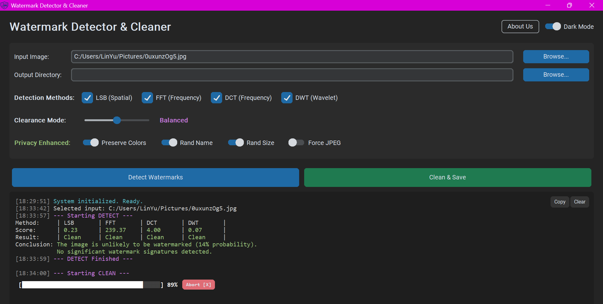

<div align="center">
  
  <h1>Watermark Detector and Cleaner</h1>
  <p>
    <a href="https://opensource.org/license/mit"></a>
    
    
    
  </p>
</div>

Detect and sanitize imperceptible digital watermarks and steganographic payloads across spatial and frequency domains. 100% offline & local processing.  
检测并脱敏图像中的隐形数字暗水印与频域载荷，中和微观特征。100% 纯本地离线处理。




## ✨ What's New 
- **Modern UI & Asynchronous Engine**: Fully redesigned with `CustomTkinter`. Features True Dark/Light modes, frameless dialogs, and a non-blocking asynchronous multi-threaded backend.
- **Advanced 4-Layer Detection**: 
  - `LSB (Spatial)`: Scans the least significant bits.
  - `FFT`, `DCT`, `DWT (Frequency)`: Analyzes geometric patterns in Fourier and Wavelet spectrums.
- **Adaptive Clearance Modes**: `Aggressive` (maximum removal), `Balanced` (recommended), `Conservative` (quality preservation).
- **Privacy Engine**: 
  - `Rand Name`: Hashes the output file with a random 9-character string.
  - `Rand Size`: Invokes an imperceptible micro-crop (±2px) to neutralize resolution-dependent fingerprinting.
  - `Force JPEG`: Compresses lossless images to strip container-level steganography.

## 🛠️ Usage

### Quick Start (No Installation)

1. Clone the repo and install dependencies:
```bash
git clone https://github.com/AndrewWangDev/remove_watermark.git
cd remove_watermark
pip install -r requirements.txt
```
2. Launch the app:
```bash
python src/main.py
```
3. **Workflow**: Browse for an input image -> Select your detection/privacy parameters -> Hit **Detect Watermarks** (to scan) or **Clean & Save** (to output the neutralized image).

## 📊 Scoring & Verification 
The Detection Engine runs an empirical mathematical analysis across 4 frequency and spatial dimensions to compute anomaly scores and determine a global confidence probability:

```text
--- Starting DETECT ---
Method:     | LSB       | FFT       | DCT       | DWT       | 
Score:      | 0.32      | 28.50     | 142.10    | 12.40     | 
Result:     | Clean     | Clean     | Clean     | Clean     | 
Conclusion: The image is clean / unlikely to be watermarked (0% probability).
            No significant watermark signatures detected.
--- DETECT Finished ---
```
- **LSB (Spatial)**: Measures spatial transition probability and difference energy in lowest bit-planes. Natural images have smooth neighborhoods (< 0.45); pseudo-random or encrypted steganographic payloads converge towards Bernoulli white noise (~0.500).
- **FFT / DCT / DWT**: Identifies geometric spikes, mid-frequency AC clusters, and wavelet high-frequency anomalies via fully vectorized transforms.
- **Global Probability**: A deterministic, multi-feature weighted confidence model (Weighted Confidence Evaluation). If no watermarks are detected, the score deterministically resolves to 0%.

## 🧠 Core Algorithm Architecture

This application employs a dual-domain analysis to detect and sanitize steganographic artifacts:

```text
    [ Original Suspicious Image ]
                  │
                  ▼
 ┌─────────────────────────────────┐
 │   Spatial Domain Analysis       │
 │   (Extracting LSB Bit-Planes)   │ ──► LSB Detection
 └─────────────────────────────────┘
                  │
       (FFT / DCT / DWT Transform)
                  │
                  ▼
 ┌─────────────────────────────────┐
 │  Frequency Domain Manipulation  │
 │  * Target High-Frequency Spikes │ ──► FFT/DCT/DWT Detection
 │  * Apply Low-Pass / Masking     │
 └─────────────────────────────────┘
                  │
       (Inverse Transformation)
                  │
                  ▼
      [ Sanitized Clean Image ]
```

## 🏗️ Tech Stack
- **Backend Algorithms**: OpenCV (`cv2`), Numpy, PyWavelets, Scipy
- **Frontend Engine**: CustomTkinter (Tkinter Wrapper)
- **Packaging**: PyInstaller + PIL (Dynamic Logo Generation)

## ⚖️ Disclaimer & Educational Purpose

This software is developed strictly for **academic research, digital image forensics, and privacy preservation (PETs)**.

- It demonstrates mathematical signal-filtering methodologies (Fourier, Cosine, Wavelet, and Spatial LSB analyses) and evaluates the robustness of digital steganography schemes.
- The authors and maintainers do **NOT** condone, support, or encourage the use of this tool to bypass lawful corporate security controls, violate Non-Disclosure Agreements (NDAs), infringe intellectual property rights, or commit unauthorized data exfiltration.
- Users are solely responsible for ensuring that their use of this software complies with all applicable local laws, organizational confidentiality policies, and terms of service.

