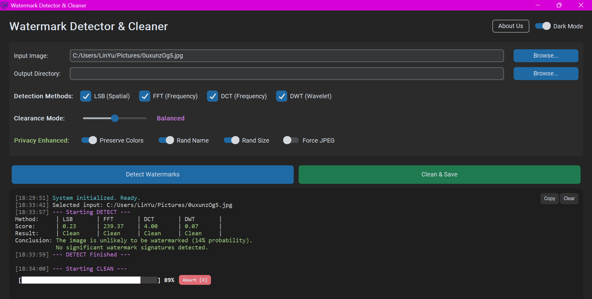

<div align="center">
  
  <h1>Watermark Detector and Cleaner</h1>
  <p>
    <a href="https://opensource.org/license/mit"></a>
    
    
    
  </p>
</div>

Detect and Remove hidden watermark in the screenshot && Randomize fingerprint to avoid tracking. 100% offline.




## ✨ What's New 
- **Modern UI & Asynchronous Engine**: Fully redesigned with `CustomTkinter`. Features True Dark/Light modes, frameless dialogs, and a non-blocking asynchronous multi-threaded backend.
- **Advanced 4-Layer Detection**: 
  - `LSB (Spatial)`: Scans the least significant bits.
  - `FFT`, `DCT`, `DWT (Frequency)`: Analyzes geometric patterns in Fourier and Wavelet spectrums.
- **Adaptive Clearance Modes**: `Aggressive` (maximum removal), `Balanced` (recommended), `Conservative` (quality preservation).
- **Privacy Engine**: 
  - `Rand Name`: Hashes the output file with a random 9-character string.
  - `Rand Size`: Invokes a micro-crop (±2px) imperceptible to the human eye to destroy resolution-based tracking.
  - `Force JPEG`: Compresses lossless images to strip container-level steganography.

## 🛠️ Usage

### Quick Start (No Installation)

1. Clone the repo and install dependencies:
```bash
git clone https://github.com/AndrewWangDev/remove_watermark.git
cd remove_watermark
pip install -r requirements.txt
```
2. Launch the app:
```bash
python src/main.py
```
3. **Workflow**: Browse for an input image -> Select your detection/privacy parameters -> Hit **Detect Watermarks** (to scan) or **Clean & Save** (to output the neutralized image).

## 📊 Scoring & Verification 
The Detection Engine runs a fully mathematical analysis to compute anomaly scores across 4 dimensions. Based on statistical thresholds, it determines a global probability of watermark existence:

```text
--- Starting DETECT ---
Method:     | LSB       | FFT       | DCT       | DWT       | 
Score:      | 0.25      | 239.23    | 43.59     | 0.15      | 
Result:     | Found     | Clean     | Clean     | Clean     | 
Conclusion: The image is unlikely to be watermarked (23% probability).
            Watermark components likely present in: LSB.
--- DETECT Finished ---
```
- **LSB (Spatial)**: Calculates entropy and bit-plane correlation. High randomness in LSB yields an anomaly score (e.g., > 0.2 threshold triggers "Found").
- **FFT / DCT / DWT**: Identifies geometric shapes or high-frequency spikes in the magnitude spectrum. A high-variance score indicates artificial manipulation.
- **Global Probability**: A weighted Bayesian combination of the 4 independent dimension scores, giving you a definitive percentage (e.g., 23%) of watermark likelihood.

## 🧠 Core Algorithm Architecture

This application employs a dual-domain analysis to expose and destroy steganographic artifacts:

```text
    [ Original Suspicious Image ]
                  │
                  ▼
 ┌─────────────────────────────────┐
 │   Spatial Domain Analysis       │
 │   (Extracting LSB Bit-Planes)   │ ──► LSB Detection
 └─────────────────────────────────┘
                  │
       (FFT / DCT / DWT Transform)
                  │
                  ▼
 ┌─────────────────────────────────┐
 │  Frequency Domain Manipulation  │
 │  * Target High-Frequency Spikes │ ──► FFT/DCT/DWT Detection
 │  * Apply Low-Pass / Masking     │
 └─────────────────────────────────┘
                  │
       (Inverse Transformation)
                  │
                  ▼
      [ Sanitized Clean Image ]
```

## 🏗️ Tech Stack
- **Backend Algorithms**: OpenCV (`cv2`), Numpy, PyWavelets, Scipy
- **Frontend Engine**: CustomTkinter (Tkinter Wrapper)
- **Packaging**: PyInstaller + PIL (Dynamic Logo Generation)
